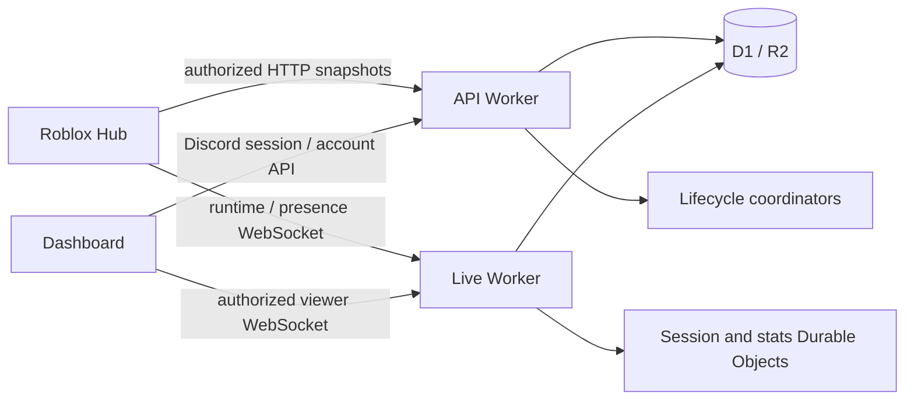
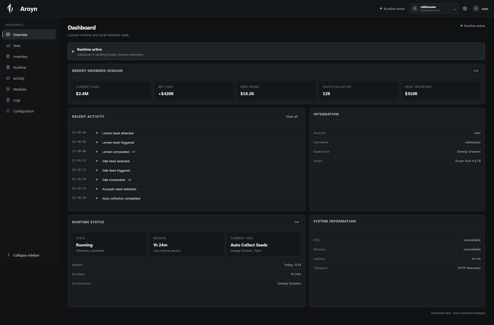

# Aroyn

Aroyn combines game-specific Roblox controls with an optional web dashboard for runtime telemetry. The Hub supports **Greedy Growers**; the dashboard lets an account owner view supported session, inventory and activity information. A separate **Aroyn UI Library** provides reusable native Roblox interfaces without game automation or telemetry.

This repository publishes the dashboard, API/Live backend, shared lifecycle helpers, tests and the modular Hub 4.3.96 and standalone UI v0.1.0 projects. Original repository code is [MIT licensed](LICENSE). The hosted products and this source tree currently have different release coverage; the table below makes that boundary explicit.

## Components and source availability

| Component | What it does | Source and distribution |
|---|---|---|
| Dashboard | Discord sign-in, authorized runtime views, account export/deletion | `apps/dashboard/`; static HTML/CSS/JavaScript |
| API | Account/session/key authorization, HTTP snapshots and account lifecycle | `workers/api/` and `workers/shared/` |
| Live backend | WebSocket runtime/viewer relay, signed presence and scoped live access | `workers/live/`; Cloudflare Durable Objects, D1 and R2 |
| Hub | Seed buying, collection, compost, market and pet feeding controls | [Modular 4.3.96 source/build/tests](clients/greedy-growers/); immutable artifacts in `apps/dashboard/releases/` |
| UI Library | Windows, pages, controls, dialogs, notifications and named configurations | [Readable Stable v0.1.0](https://lib.aroyn.xyz/stable/0.1.0/Aroyn.lua), with [MIT notice](https://lib.aroyn.xyz/stable/0.1.0/LICENSE); [modular source/build/tests/examples](libraries/ui/) are included here |
| Product documentation | Hub and UI reference sites | [Hub docs](https://docs.aroyn.xyz/hub/) · [UI docs](https://docs.aroyn.xyz/ui/); their site generator is not yet in this repository |

The official frontend has a newer homepage than the checked-in snapshot. Production resource identifiers, secrets, credentials and user records are not part of the source distribution. [Source provenance](docs/source-provenance.md) distinguishes MIT software, permitted supplied branding, project-authored icons and retained historical assets.

## Architecture



Detailed snapshots require a dashboard key. Basic presence can be reported without linking; caller-supplied Roblox IDs do not prove account ownership. The reusable UI Library neither runs gameplay nor connects to these services. Legacy `Veyra` class, column and service names remain for compatibility. See [architecture](docs/architecture.md), [account data](docs/account-data.md) and [presence](docs/presence-websocket.md).

## Preview



This image is a local demonstration, not a real user session or adoption evidence. [UI documentation](https://docs.aroyn.xyz/ui/) includes authentic owner-provided Roblox captures; screenshots do not establish support for every device or executor.

## Start contributing locally

Use **Node.js 24** for the tested development environment. From a clone:

```sh
npm ci --ignore-scripts
npm test
```

The test harness uses synthetic D1/R2/DO stores and mocked external Discord/Roblox responses. It refuses non-mock backend mode. No production credentials or Cloudflare account are needed for this gate. Some client checks download a pinned official Luau CLI and verify its archive hash; npm installation also needs network access.

For a frontend preview:

```sh
cd apps/dashboard
npm run dev
```

Open `http://127.0.0.1:4173`. No dashboard package installation is needed. Defaults in `assets/js/core/config.js` use local API/Live ports **8787/8788**; the preview alone does not implement sign-in or telemetry. The separately configured copy-script action links to the official public loader.

### Backend development

For credential-free changes, begin with the synthetic harness and [testing guide](docs/testing.md). Full self-hosting requires your own Discord OAuth application and matching Worker configuration, D1 schema, R2 buckets, signing secrets and Durable Object bindings.

Copy each `wrangler.example.jsonc` to a Git-ignored `wrangler.jsonc`; populate local `.dev.vars` from `.dev.vars.example`. Apply all **six** SQL migrations to your local store, and keep API/Live persistence aligned. Never use Aroyn's production resources or credentials for contributor tests.

The API binds to a stats Durable Object exported by Live. Independently starting two Wrangler processes is **not** a verified complete local topology. A multi-Worker session exposes the primary Worker but does not automatically expose both dashboard endpoints. The current credential-free integration path is the shared Miniflare harness. [Setup](docs/setup.md) separates the supported local paths and remaining self-hosting work.

## Tests and CI

[GitHub Actions](https://github.com/vmsize/aroyn/actions/workflows/checks.yml) runs the same root install/test commands on Linux with Node.js 24 and read-only repository permissions. Coverage includes authorization races, revocation, deletion/retention/recovery, telemetry reconstruction, mobile client layout and cancellation. Browser-component and Luau tests use explicit doubles; they are distinct from real browser and native Roblox checks.

Optional larger synthetic checks:

```sh
npm run test:capacity
npm run test:account-capacity
```

These exercise larger local fixture stores, not production cost or capacity. Record the commit, environment, commands, results and limitations with any contribution. See [testing](docs/testing.md).

## Build the current Luau projects

Use Python 3.12+ and Node.js 24 from the repository root:

```sh
python clients/greedy-growers/tools/build.py --output .build/hub
python libraries/ui/tools/build.py --output .build/ui
python clients/greedy-growers/tests/run.py
python libraries/ui/tests/run.py
```

Outputs must be empty directories. Both builders verify source identities, compile with the checksum-pinned official Luau 0.740 CLI and require exact equality with the existing immutable release. UI Stable v0.1.0 is **232227 bytes**, SHA256 `afc4a8ff0f91e64ef4d99fc60e4a23b5c9e33e407051d40a37328c4c8c70689a`. See the [Hub](clients/greedy-growers/README.md) and [UI Library](libraries/ui/README.md) guides for examples, lifecycle and asset-generation instructions.

The separate [Luau workflow](.github/workflows/luau.yml) runs these builds and mocked regressions on Linux. Neither workflow deploys or uses production credentials. Tests are not native Roblox rendering approval.

## Hosted releases and compatibility

As independently checked on **2026-10-12**, the [public manifest](https://aroyn.xyz/scripts/version.json) selects **Hub 4.3.96**. Its [immutable executable](https://aroyn.xyz/releases/4.3.96/greedy-growers.luau) is **836402 bytes**, SHA256:

```text
f72f5bc0180c7fc9c7b92027f4a24a3adcbbc68713ae2fe44973b6974b1cf97e
```

The stable [loader](https://aroyn.xyz/scripts/loader.luau) resolves the manifest-selected release. It checks size and HTML fallback, but does **not** independently validate SHA256 inside Roblox. Hosted deployment is a separate approval process; running tests or publishing GitHub documentation does not activate a client release.

The owner reported successful tests of the exact 4.3.96 artifact on **Windows/Potassium and Android/Delta**. This does not establish compatibility with other executors, iOS, Studio or every phone. The standalone UI Library v0.1.0 has a separate **Windows PC/Potassium** support scope; Hub Android approval does not transfer to it.

Hub 4.3.96 introduces the custom UI, responsive eight-tab navigation, seamless startup, preference AutoSave, profile recovery and confirmed Dashboard reconnection intent. Gameplay automation remains off on startup/profile restoration. Older 4.3.95 settings restoration differs; downgrade is not behaviorally equivalent. See [client release](docs/client-release.md) and [compatibility](docs/compatibility.md).

## Contributions

Useful contributions include synthetic regressions, clear setup instructions, data lifecycle correctness, telemetry reconstruction, frontend accessibility and release verification. Start with a focused issue; describe the component and reproduction without private data. [CONTRIBUTING.md](CONTRIBUTING.md) explains the workflow and module boundaries.

Hub and library sources include portable build/test tooling. A complete coordinated self-hosting launcher remains future work. Do not change immutable release bytes as a routine cleanup.

## Security, privacy and limitations

Report vulnerabilities privately through [SECURITY.md](SECURITY.md). Never put dashboard keys, cookies, OAuth secrets, real account records or production configuration in an issue, PR, example or automated review request.

Account export/deletion and retention have defined scope and operational limits. Anonymous presence statistics are observed records, not verified humans; [usage evidence](docs/usage.md) documents the historical measurement method. Local tests and short health checks do not establish production capacity, uptime, legal compliance or accessibility certification.

Executing a Hub/library download runs Luau in a compatible environment. Inspect the source and permissions; this repository does not distribute executors. Hub tools do not automate every part of the farm, and game changes can invalidate integrations.

## Official links

- [Website](https://aroyn.xyz/) · [Dashboard](https://aroyn.xyz/dashboard/) · [Service status](https://aroyn.xyz/status/)
- [Hub documentation](https://docs.aroyn.xyz/hub/) · [UI Library documentation](https://docs.aroyn.xyz/ui/)
- [Pinned UI Library v0.1.0](https://lib.aroyn.xyz/stable/0.1.0/Aroyn.lua)
- [User guide](docs/user-guide.md) ([Русский](docs/user-guide.ru.md)) · [Current status](docs/product-status.md) · [Release verification](docs/release-verification.md)

## License and attribution

Original repository software: **MIT**, copyright **2026 vmsize**. Preserve [LICENSE](LICENSE) and [THIRD_PARTY_NOTICES.md](THIRD_PARTY_NOTICES.md). Brand names and supplied marks are excluded from the software MIT grant; [BRAND_ASSETS.md](BRAND_ASSETS.md) permits unchanged redistribution within source forks and truthful references, with limits on separate branding and endorsement.

Legacy client icon-strip provenance remains unresolved in the notices. The new Hub and standalone atlases have checked-in project-authored generators and a separate provenance record; they do not use that legacy strip. Code licensing, third-party assets and branding have distinct terms.
